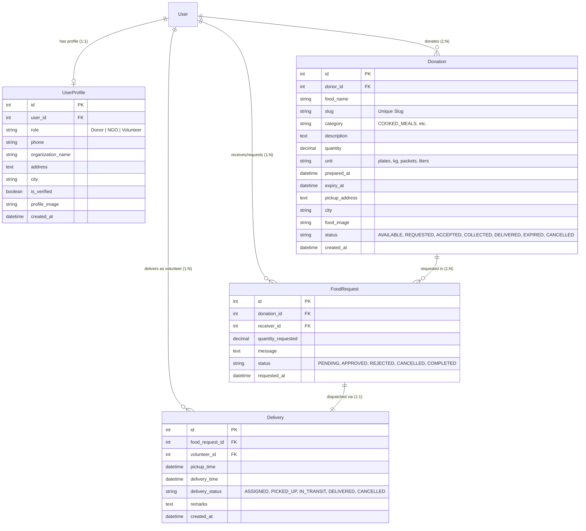

# FoodRescue – Food Donation & Redistribution Management Platform

**Academic Course Assignment:** INT253 Web Development in Python Using Django  
**Project Architecture:** Model-View-Template (MVT) Pattern  
**Backend:** Python 3.x & Django Framework (Django ORM)  
**Database:** SQLite (`db.sqlite3`)  
**Frontend:** HTML5, CSS3, Vanilla JavaScript, Bootstrap 5.3, Bootstrap Icons  

---

## 1. Project Overview & Objectives

**FoodRescue** is a database-driven web application built to reduce edible food waste by connecting food donors (hotels, restaurants, catering agencies, banquets, and households) with verified charities, orphanages, shelters, and community food banks in real-time.

Registered volunteers transport fresh food packages safely from donors to receivers, closing the redistribution loop with transparent tracking and digital audit logging.

### Key Highlights
- **Zero Placeholder Data:** 100% of application records (donations, requests, deliveries, user profiles) are dynamically queried from the SQLite database via Django ORM.
- **Role-Based Portals:** Individualized dashboards and access control for **Donors**, **NGOs / Receivers**, **Volunteers**, and **Administrators**.
- **Hyperlocal Discovery:** Real-time food search by keyword, category, locality, and expiry timestamps.
- **RESTful JSON Endpoints:** Embedded API feeds providing asynchronous data for frontend widgets and third-party integrations.

---

## 2. Technology Stack

| Layer | Technologies Used |
| :--- | :--- |
| **Backend Framework** | Django 6.x / Python 3.14 |
| **Database Engine** | SQLite (Django ORM relational models) |
| **Authentication** | Django Auth (`auth.User`, session middleware, hashed passwords) |
| **Template Engine** | Django Template Language (DTL) with template inheritance |
| **UI Framework** | Bootstrap 5.3 (Responsive CSS Grid & Flexbox) |
| **Iconography** | Bootstrap Icons 1.11.3 |
| **Image Processing** | Pillow (PIL) |
| **Testing Harness** | Django Test Framework (`django.test.TestCase`, `Client`) |

---

## 3. Quick Start & Execution Guide

### Prerequisites
- Python 3.10+ installed on your operating system.

### Step 1: Clone / Navigate to Project Directory
```bash
cd "FoodRescue Django"
```

### Step 2: Activate the Virtual Environment
On macOS / Linux:
```bash
source venv/bin/activate
```
On Windows:
```cmd
venv\Scripts\activate
```

*(If creating a fresh virtual environment from scratch: `python3 -m venv venv && source venv/bin/activate && pip install -r requirements.txt`)*

### Step 3: Apply Database Migrations
```bash
python manage.py makemigrations accounts donations requests
python manage.py migrate
```

### Step 4: Populate Seed Demo Data (Viva Ready)
Populates realistic users, food donations, incoming requests, and delivery runs:
```bash
python manage.py seed_demo_data
```

### Step 5: Run Automated Unit Tests
```bash
python manage.py test
```

### Step 6: Start the Development Server
```bash
python manage.py runserver
```
Visit **[http://127.0.0.1:8000/](http://127.0.0.1:8000/)** in your browser.

---

## 4. Indian Demo User Accounts for Viva Examination

The database comes pre-seeded with authentic Indian accounts for all user roles:

| Role | Username | Password | Organization / City |
| :--- | :--- | :--- | :--- |
| **Administrator** | `admin` | `admin123` | Kalyan Chakravarthy (Directorate, Hyderabad) |
| **Donor 1 (Hotel)** | `taj_hotel` | `donor123` | Grand Taj Banjara Hotel & Banquets, Hyderabad |
| **Donor 2 (Bakery)**| `city_bakery` | `donor123` | Karachi Bakery & Sweets, Abids, Hyderabad |
| **Donor 3 (Caterer)**| `annapurna_caterers`| `donor123` | Annapurna Wedding Caterers, Indiranagar, Bengaluru |
| **NGO 1 (Trust)** | `hope_shelter` | `ngo12345` | Akshaya Seva Food Foundation & Shelter, Secunderabad |
| **NGO 2 (Care Home)**| `sunshine_home`| `ngo12345` | Sneha Children Welfare Home, Jubilee Hills, Hyderabad |
| **Volunteer 1** | `alex_courier` | `vol12345` | Ramesh Kumar (Hyderabad Metro Courier Hero) |
| **Volunteer 2** | `priya_express` | `vol12345` | Priya Sharma (Bengaluru Green Logistics Courier) |

---

## 5. Entity-Relationship (ER) Diagram



---

## 6. URL-to-View Mapping Table

The routing satisfies all mandatory path converter and regular expression specifications:

| Path Converter / Pattern | URL Pattern | View Name | Application & Purpose |
| :--- | :--- | :--- | :--- |
| **Root** | `/` | `donations:home` | Public Landing Page with live DB metrics |
| **Standard** | `/donations/` | `donations:donation_list` | Database search, category & city filtering |
| **`slug` converter** | `/donations/detail/<slug:slug>/` | `donations:donation_detail_slug` | Full food detail using SEO slug |
| **`int` converter** | `/donations/id/<int:pk>/` | `donations:donation_detail_id` | Primary key lookup & redirect |
| **`re_path()` Regex** | `r'^donations/category/(?P<category_code>[a-zA-Z0-9_-]+)/$'` | `donations:donation_by_category` | Category filtering via regex pattern |
| **`str` converter** | `/accounts/role/<str:role_name>/` | `accounts:role_info` | Role guidelines (`donor`, `ngo`, `volunteer`) |
| **JSON API** | `/api/donations/` | `donations:api_donations` | `JsonResponse` live search data |
| **JSON API** | `/api/stats/` | `donations:api_stats` | `JsonResponse` real-time platform impact statistics |
| **Role Dashboard** | `/accounts/redirect/` | `accounts:dashboard_redirect` | Dynamic role routing to specific portal |
| **Donor Dashboard**| `/donor/dashboard/` | `donations:donor_dashboard` | Donor overview metrics & incoming requests |
| **Donor CRUD** | `/donor/donations/create/` | `donations:donor_add_donation` | Create surplus food donation |
| **Donor CRUD** | `/donor/donations/` | `donations:donor_my_donations` | List user donations with status filters |
| **Donor CRUD** | `/donor/donations/<int:pk>/edit/` | `donations:donor_edit_donation` | Update donation details |
| **Donor CRUD** | `/donor/donations/<int:pk>/delete/`| `donations:donor_delete_donation` | Confirm & delete donation |
| **Donor Action** | `/donor/requests/<int:pk>/accept/` | `requests:donor_accept_request` | Accept request & generate Delivery task |
| **Donor Action** | `/donor/requests/<int:pk>/reject/` | `requests:donor_reject_request` | Reject food request |
| **NGO Dashboard** | `/ngo/dashboard/` | `requests:ngo_dashboard` | Receiver metrics & nearby donations |
| **NGO Request** | `/requests/create/<int:donation_id>/` | `requests:request_food` | Submit request for surplus food batch |
| **NGO My Requests**| `/ngo/requests/` | `requests:ngo_my_requests` | Track delivery dispatch & courier status |
| **Volunteer Hub** | `/volunteer/dashboard/` | `requests:volunteer_dashboard` | Courier metrics & claimed tasks |
| **Volunteer Tasks**| `/volunteer/deliveries/` | `requests:volunteer_deliveries` | Claimable pickups & active runs |
| **Volunteer Action**| `/volunteer/deliveries/<int:pk>/` | `requests:volunteer_delivery_detail` | Mark Collected & Mark Delivered |
| **Admin Overview**| `/admin-dashboard/` | `donations:admin_dashboard` | High-level platform health & viva showcase |
| **Django Admin** | `/admin/` | `admin:index` | Built-in Django administration site |

---

## 7. Mandatory Academic Requirements Compliance Matrix

This project strictly meets all standards specified in the **INT253 Web Development in Python Using Django** assignment:

| # | Academic Requirement | Implementation Details in FoodRescue | Status |
| :- | :--- | :--- | :-: |
| **A** | **At least two Django applications** | Three modular applications: `accounts`, `donations`, and `requests` registered in `settings.py`. | Verified |
| **B** | **URL Routing with converters** | Implemented `int`, `str`, and `slug` path converters, plus a regex pattern with `re_path()`. | Verified |
| **C** | **GET & POST Handling** | All forms validate CSRF tokens, handle GET/POST, provide DB search/filters, and use `get_object_or_404`. | Verified |
| **D** | **JSON API Endpoints** | Provided `/api/donations/` and `/api/stats/` returning `JsonResponse` payloads for live widgets. | Verified |
| **E** | **Template Inheritance & DTL** | Common `base.html`, reusable includes (`navbar`, `footer`, `status_badge`, `donation_card`, `dashboard_sidebar`), DTL loops, filters (`date`, `timesince`, `truncatewords`). | Verified |
| **F** | **Django ORM CRUD** | 4 related models (`UserProfile`, `Donation`, `FoodRequest`, `Delivery`) with zero hardcoded python lists. | Verified |
| **G** | **Automated Testing** | 7 automated unit tests in `donations/tests.py` covering endpoints, auth, CRUD, search, 404, and lifecycles. | Verified |
| **H** | **Custom Error Pages** | Clean branded `404.html` and `500.html` templates configured in `foodrescue/urls.py`. | Verified |

---

## 8. Directory Structure

```text
FoodRescue Django/
├── accounts/
│   ├── admin.py             # UserProfileAdmin with verification actions
│   ├── context_processors.py# Global user profile context processor
│   ├── decorators.py        # Role guards (@donor_required, @ngo_required, @volunteer_required)
│   ├── forms.py             # Registration and Profile editing forms
│   ├── models.py            # UserProfile model with User 1:1 relation & signals
│   ├── tests.py
│   ├── urls.py              # Account auth & role info routes
│   └── views.py             # Register, Login, Logout, Profile, Role Info
├── donations/
│   ├── admin.py             # DonationAdmin with slug prepopulation & filters
│   ├── forms.py             # Donation creation & validation form
│   ├── management/commands/
│   │   └── seed_demo_data.py# Management command to seed complete demo dataset
│   ├── models.py            # Donation model with auto slug & expiry validation
│   ├── tests.py             # 7 Comprehensive Django unit test cases
│   ├── urls.py              # Home, search, slug, int, regex, json APIs, donor CRUD
│   ├── views.py             # Public pages, search, APIs, donor views, admin overview
│   └── views_errors.py      # Custom 404 & 500 error handlers
├── requests/
│   ├── admin.py             # FoodRequestAdmin & DeliveryAdmin
│   ├── forms.py             # FoodRequestForm & DeliveryStatusUpdateForm
│   ├── models.py            # FoodRequest & Delivery logistics models
│   ├── urls.py              # NGO requests & Volunteer delivery routes
│   └── views.py             # NGO requesting, Donor approvals, Volunteer tracking
├── foodrescue/
│   ├── asgi.py
│   ├── settings.py          # Apps, templates, media, static, message tags configuration
│   ├── urls.py              # Root routing table & custom error handlers
│   └── wsgi.py
├── static/
│   ├── css/style.css        # Forest green & dark green modern sustainability theme
│   └── js/main.js           # Live async search widget & alert dismissers
├── templates/
│   ├── 404.html             # Custom Not Found error template
│   ├── 500.html             # Custom Server Error template
│   ├── base.html            # Base master layout template
│   ├── accounts/            # register.html, login.html, profile.html, role_info.html
│   ├── donations/           # home.html, about.html, how_it_works.html, contact.html,
│   │                        # donation_list.html, donation_detail.html, donation_by_category.html,
│   │                        # donor_dashboard.html, donor_add_donation.html, donor_my_donations.html,
│   │                        # donor_edit_donation.html, donor_delete_confirm.html, admin_dashboard.html
│   ├── includes/            # navbar.html, footer.html, messages.html, donation_card.html,
│   │                        # status_badge.html, dashboard_sidebar.html
│   └── requests/            # ngo_dashboard.html, request_food.html, ngo_my_requests.html,
│                            # request_cancel_confirm.html, donor_incoming_requests.html,
│                            # donor_request_action.html, volunteer_dashboard.html,
│                            # volunteer_deliveries.html, volunteer_claim_confirm.html,
│                            # volunteer_delivery_detail.html
├── media/                   # User uploaded images directory
├── requirements.txt         # Project Python dependencies
├── manage.py                # Django CLI utility
└── README.md                # Project documentation and guide
```

---

## 9. Viva Examination Cheatsheet

When demonstrating this project to the examiner, highlight the following workflow:

1. **Homepage Demonstration (`/`):**
   - Point out the hero section and live statistics pulled dynamically from the database (`Donation.objects.count()`, `Sum('quantity')`, verified NGOs).
   - Use the **Instant Food Finder** widget to demonstrate the `/api/donations/?q=...` asynchronous JSON endpoint.
2. **URL Routing Converters:**
   - Click on any donation to show the **`slug`** path converter (`/donations/detail/hyderabadi-veg-dum-biryani-with-mirchi-ka-salan/`).
   - Show `/donations/id/1/` to demonstrate the **`int`** converter redirecting to the canonical slug.
   - Click on **Filter via Regex Pattern** on the donation list page to demonstrate **`re_path()`** at `/donations/category/COOKED_MEALS/`.
   - Click on **Community Roles** in the footer to demonstrate the **`str`** path converter at `/accounts/role/donor/`.
3. **End-to-End Role Lifecycle:**
   - **Log in as Donor (`taj_hotel` / `donor123`):** Show the Donor Dashboard with metrics, post a new donation, and review incoming requests.
   - **Log in as NGO (`hope_shelter` / `ngo12345`):** Browse donations, filter by Cooked Meals, and submit a formal request for food.
   - **Switch back to Donor:** Approve the NGO's pending request. Note that this automatically triggers a `Delivery` object for volunteers.
   - **Log in as Volunteer (`alex_courier` / `vol12345`):** Claim the newly approved delivery task. Tap **Mark as Collected (Start Transit)** and then **Confirm Successful Delivery**.
   - Notice the status badge transitions across the lifecycle: `Available` &rarr; `Requested` &rarr; `Accepted` &rarr; `In Transit` &rarr; `Delivered`.
4. **Platform Administration (`admin` / `admin123`):**
   - Visit `/admin-dashboard/` for the executive platform view.
   - Visit `/admin/` to show Django's built-in administration panel with model filters, search fields, list displays, and custom actions (such as *Verify selected NGOs*).
